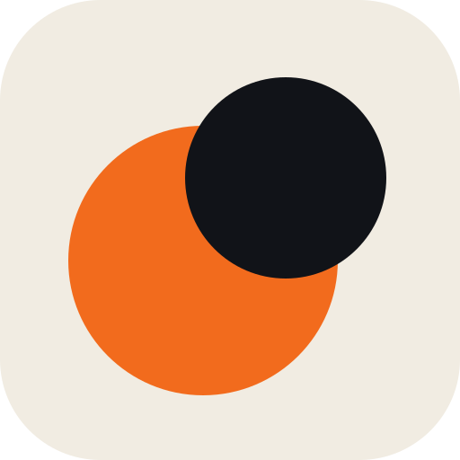
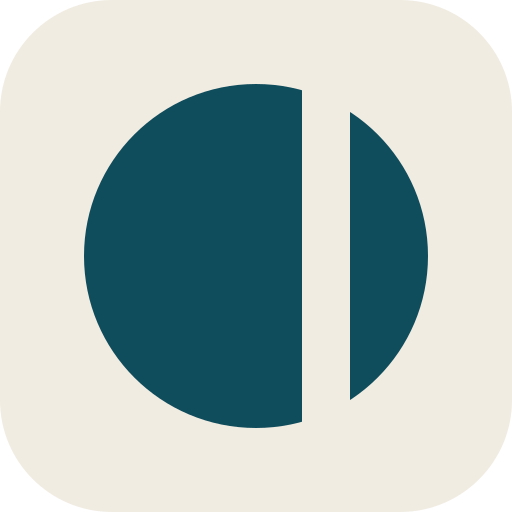

# Spectra logo directions

These are **proposals for Lu to choose from** (issue #9). As of
23 November 2026, none of these had been chosen, and the app icon
inherited from Helium was unchanged.

These are directions, not final art. Once Lu picks one, it gets redrawn
properly as a clean vector, with tuned proportions, optical corrections and
small-size hinting. Do not use these SVGs or PNGs as a pixel spec.

Each mark is a bold, flat silhouette on a rounded app tile. Each has its own
limited palette, with no gradients and no rainbow. Pink is not used.

The contact sheet shows each mark at 192 px, then at 64, 32 and 16 px on a
light ground and on a dark ground. The last column is a dark browser tab with
the mark at true 16 px favicon size. The source is
`logo-directions/contact-sheet.svg`.

## The marks

### A. Eclipse

- **Draws on:** helium was first found as a spectral line seen during the
  1868 solar eclipse. A dark moon disc passes over an orange sun.
- **Palette:** solar orange `#F26B1D`, near-black ink `#111318`, warm bone
  `#F1ECE2`. One hot colour, one dark and one neutral; the orange carries the
  warmth with no other hue competing.
- **At small size:** two discs stay readable at 16 px. The moon is kept
  noticeably smaller than the sun and offset diagonally, so the mark does not
  read as two equal interlocking circles.

### B. Found line

- **Draws on:** the single unknown line in sunlight. A solid disc is split by
  one clean vertical gap, set off centre the way a line sits at one place in
  a spectrum.
- **Palette:** deep teal `#0F4C5C` on warm bone `#F1ECE2`. A two-colour mark
  that stays calm and works as a monochrome stamp too.
- **At small size:** the gap is drawn wide on purpose. This is the simplest
  silhouette of the four.
- **Note for the redraw:** the gap is 48/512 of the tile, about 1.5 px at
  16 px, so its legibility at favicon size is marginal. Widen the gap, or
  check it at 16 px, when this mark is redrawn.

### C. Viewfinder

- **Draws on:** a browser as the place you look through. Two heavy brackets
  frame one bright line, the line you spotted.
- **Palette:** graphite `#1D1E22`, bone `#F1ECE2`, helium yellow `#F7C948`.
  Helium's own line is yellow, so the one accent has a reason to be there.
  The yellow is used only for the line.
- **At small size:** it reads as `[ | ]` at 16 px. On a dark browser theme the
  graphite tile nearly disappears; a final version needs a lighter tile or an
  outline variant for dark UIs.

### D. Line S monogram

- **Draws on:** the S of Spectra, built from thick squared strokes. The
  middle crossing stroke is the yellow line, tying the letter to the name
  story.
- **Palette:** deep indigo violet `#2E2A5C`, bone `#F1ECE2`, helium yellow
  `#F7C948`. Violet is the far end of the visible spectrum, used here as one
  deep ground colour instead of a rainbow.
- **At small size:** the S stays clear at 16 px. The yellow middle shrinks to
  a small spot there, so the favicon reads mainly as bone on violet.

## Checked against the rejected list

None of these use a rainbow fan, a gradient arc or ring, bars, a ribbon S, a
prism, a browser window, rays, an atom or periodic tile, thin line work,
fanning wedges, a diagonal band, or a banded triangle.

Motifs that sit close to a trap, for Lu to judge:

- **A. Eclipse:** two overlapping circles have a family resemblance to some
  well-known two-circle marks. A crescent version was drawn first and dropped
  because it read as the common dark-mode moon icon.
- **B. Found line:** a disc split by one line is near the generic "contrast"
  icon. It also shares a circle with the rejected indigo circle with an amber
  band, but here the line is a gap, vertical and off centre, not a coloured
  diagonal slash.
- **C. Viewfinder:** brackets can read as code (`[ ]`) or as a camera or
  scanner focus frame.
- **D. Line S monogram:** the squared S can read as a 5 at a glance. It is a
  letter S, not the rejected S ribbon, but it is still an S.
- **D. Line S monogram:** deep indigo with yellow is close to the palette of
  the rejected indigo circle with a thick amber band. D differs in form: a
  squared S letterform on a tile, with no circle and no band across it.

## How the images were made

The SVGs are hand-written shapes, written by a small throwaway script that is
not part of this repository. The contact sheet PNG was rendered from
`contact-sheet.svg` with macOS Quick Look (`qlmanage`). The 16 px sizes were
checked in that render and as separate 16 px renders of each mark.
