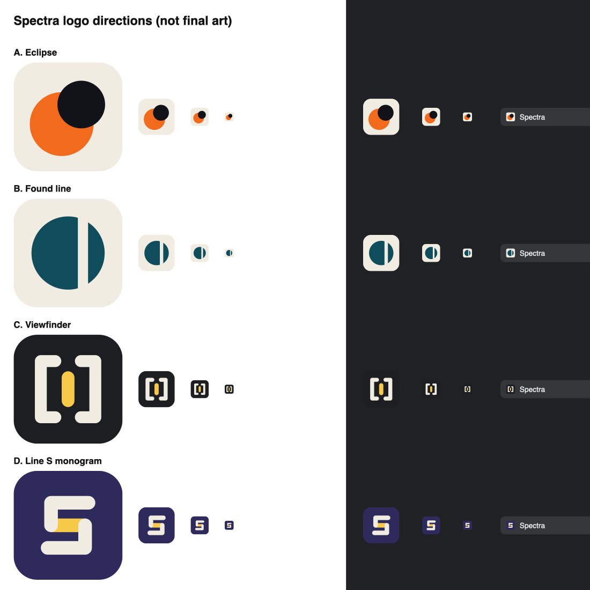
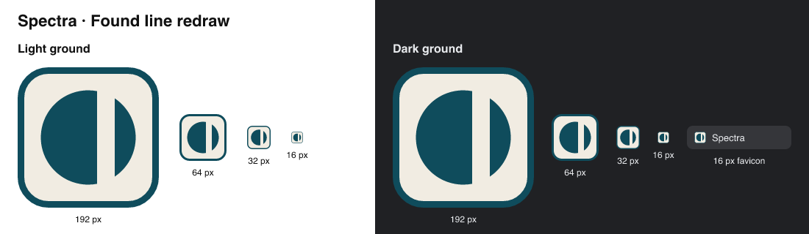
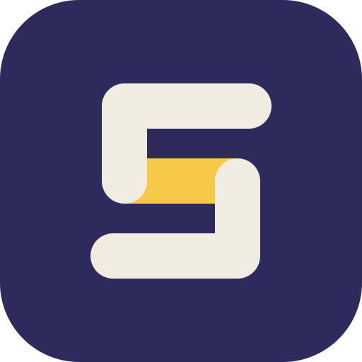

# Spectra logo directions

These are the four proposals from issue #9. Lu chose **B. Found line**.
Issue #11 tracks the [redraw for review](#found-line-redraw).

The original proposal SVGs and PNG record the design exploration. Use the
separate redraw for the review of proportions and small-size legibility.

Each mark is a bold, flat silhouette on a rounded app tile. Each has its own
limited palette, with no gradients and no rainbow. Pink is not used.



The original contact sheet shows each mark at 192 px on white and at 64,
32 and 16 px on light and dark grounds. The last column is a dark browser
tab with the mark at true 16 px favicon size. The source is
`logo-directions/contact-sheet.svg`.

## The marks

### A. Eclipse


- **Draws on:** helium was first found as a spectral line seen during the
  1868 solar eclipse. A dark moon disc passes over an orange sun.
- **Palette:** solar orange `#F26B1D`, near-black ink `#111318`, warm bone
  `#F1ECE2`. One hot colour, one dark and one neutral; the orange carries the
  warmth with no other hue competing.
- **At small size:** two discs stay readable at 16 px. The moon is kept
  noticeably smaller than the sun and offset diagonally, so the mark does not
  read as two equal interlocking circles.

### B. Found line


- **Draws on:** the single unknown line in sunlight. A solid disc is split by
  one clean vertical gap, set off centre the way a line sits at one place in
  a spectrum.
- **Palette:** deep teal `#0F4C5C` on warm bone `#F1ECE2`. A two-colour mark
  that stays calm and works as a monochrome stamp too.
- **At small size:** the gap is drawn wide on purpose. This is the simplest
  silhouette of the four.
- **Original draft:** the gap was 48 of 512 units wide, or 1.5 px at 16 px.

#### Found line redraw

[Review SVG](logo-directions/b-found-line-redraw.svg)



The bone tile has a 24-unit outline in the same teal as the disc. The gap
is 64 of 512 units wide and sits 64 units to the right of the disc centre.
At 16 px the gap spans two whole pixels. The tile, disc and both palette
colours carry through from the original proposal.

The PNG shows the mark at native size without relying on Markdown SVG
rendering. To regenerate it at 1×, run from the repository root:

```sh
resvg docs/logo-directions/b-found-line-redraw-contact-sheet.svg \
  docs/logo-directions/b-found-line-redraw-contact-sheet.png
```

### C. Viewfinder


- **Draws on:** a browser as the place you look through. Two heavy brackets
  frame one bright line, the line you spotted.
- **Palette:** graphite `#1D1E22`, bone `#F1ECE2`, helium yellow `#F7C948`.
  Helium's own line is yellow, so the one accent has a reason to be there.
  The yellow is used only for the line.
- **At small size:** it reads as `[ | ]` at 16 px. On a dark browser theme the
  graphite tile nearly disappears; a final version needs a lighter tile or an
  outline variant for dark UIs.

### D. Line S monogram



- **Draws on:** the S of Spectra, built from thick squared strokes. The
  middle crossing stroke is the yellow line, tying the letter to the name
  story.
- **Palette:** deep indigo violet `#2E2A5C`, bone `#F1ECE2`, helium yellow
  `#F7C948`. Violet is the far end of the visible spectrum, used here as one
  deep ground colour instead of a rainbow.
- **At small size:** the S stays clear at 16 px. The yellow middle shrinks to
  a small spot there, so the favicon reads mainly as bone on violet.

## Checked against the rejected list

None of these use a rainbow fan, a gradient arc or ring, bars, a ribbon S, a
prism, a browser window, rays, an atom or periodic tile, thin line work,
fanning wedges, a diagonal band, or a banded triangle.

Motifs that sit close to a trap, for Lu to judge:

- **A. Eclipse:** two overlapping circles have a family resemblance to some
  well-known two-circle marks. A crescent version was drawn first and dropped
  because it read as the common dark-mode moon icon.
- **B. Found line:** a disc split by one line is near the generic "contrast"
  icon. It also shares a circle with the rejected indigo circle with an amber
  band, but here the line is a gap, vertical and off centre, not a coloured
  diagonal slash.
- **C. Viewfinder:** brackets can read as code (`[ ]`) or as a camera or
  scanner focus frame.
- **D. Line S monogram:** the squared S can read as a 5 at a glance. It is a
  letter S, not the rejected S ribbon, but it is still an S.
- **D. Line S monogram:** deep indigo with yellow is close to the palette of
  the rejected indigo circle with a thick amber band. D differs in form: a
  squared S letterform on a tile, with no circle and no band across it.

## Tile contrast against browser surfaces

Measured contrast between the original proposal tiles and the surfaces in
their contact sheet.

- **A. Eclipse and B. Found line:** the bone tile `#F1ECE2` is faint on
  white, at 1.18:1. The Found line redraw adds a teal outline.
- **C. Viewfinder:** the graphite tile `#1D1E22` almost vanishes on a
  `#202124` dark browser theme, at 1.03:1. In the redraw, it needs a light
  outline or a different tile tone for dark surfaces.
- **D. Line S monogram:** the violet tile `#2E2A5C` almost vanishes on a
  `#35363A` dark tab, at 1.09:1. In the redraw, it needs a light outline or a
  different tile tone for dark tabs.

## How the images were made

The SVGs are hand-written shapes, written by a small throwaway script that is
not part of this repository. The contact sheet PNG was rendered from
`contact-sheet.svg` at its native 1100 by 1040 px, at 1x with no scaling or
cropping, using resvg. The 16 px sizes were checked in that render and as
separate 16 px renders of each mark.
