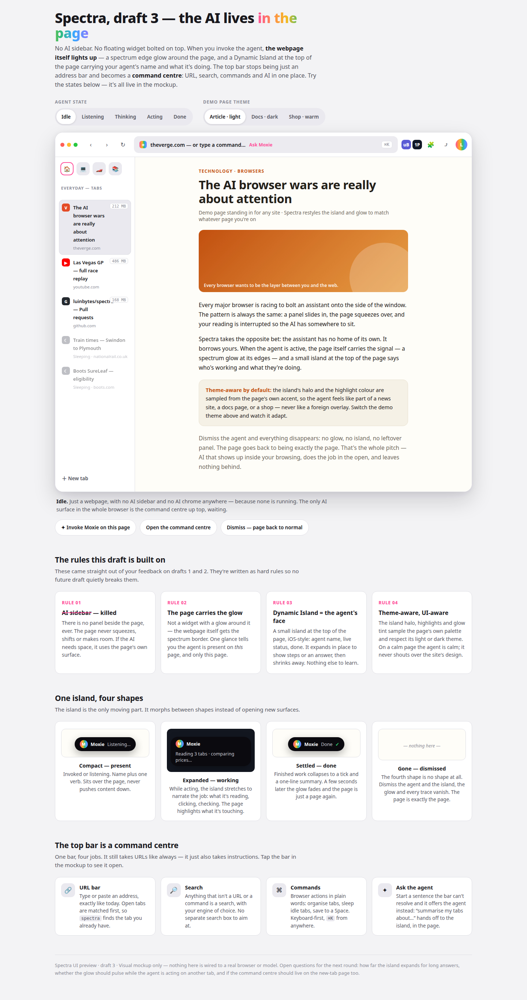
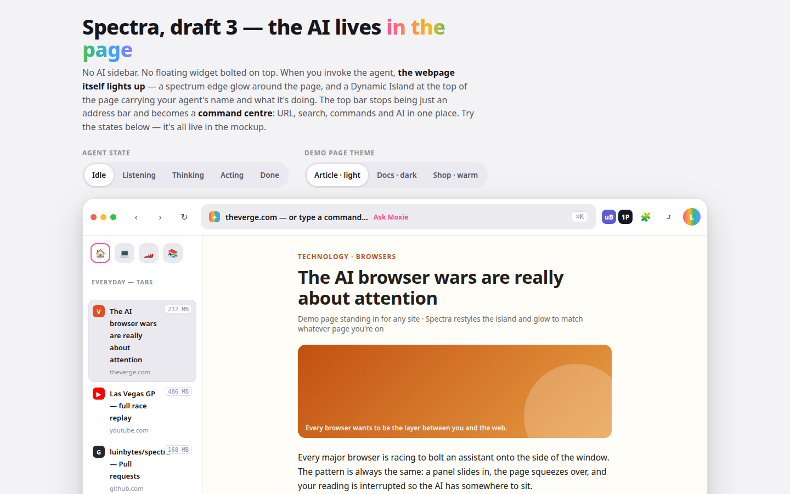
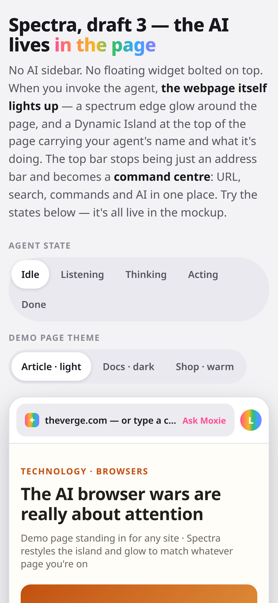
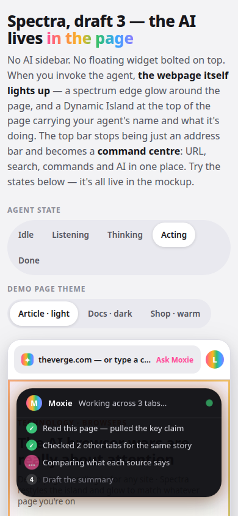
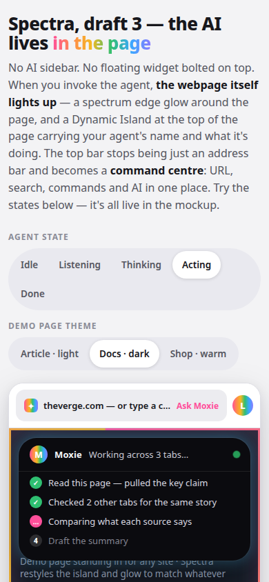
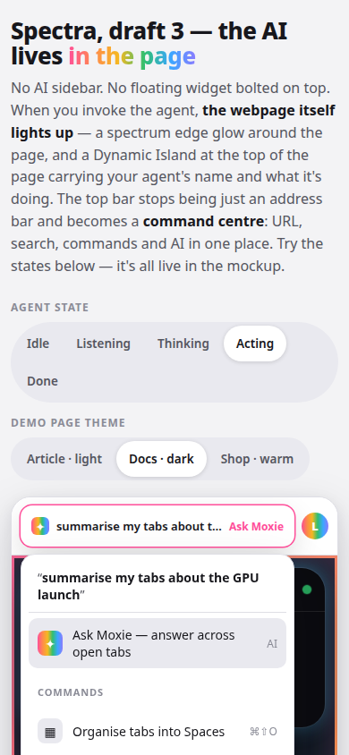

# Spectra UI direction

Status: locked by Lu on 2026-11-23 as a **proof of concept**.

Read this first if you are building from it, human or agent: the preview
linked below is a rough draft. Locked means the principles in this document,
not the draft's pixels. Do not remake the draft one to one. Its exact layout,
spacing, typography, colours beyond the spectrum identity, and all
placeholder copy are disposable. The principles are the requirements.

The interactive draft is the "Spectra UI Preview" page (draft 3, built
2026-11-23). The screenshots in `docs/images/` are captures of that draft.

## What is locked, what is draft, what is placeholder

| Layer | What it covers | Status |
| --- | --- | --- |
| Principles | The seven numbered rules below | Locked. Change only with Lu. |
| Draft behaviour | Island state mapping, sizing limits, accessibility and motion notes, draft answers to the open questions | Proposed. Build from it, and change it when evidence shows a better way within the principles. |
| Draft visuals | Layout, spacing, type, sizes, icons, the island's exact shapes | Disposable. Use the captures for reference only. |
| Placeholder copy | The agent name "Moxie", the demo sites and articles, tab titles, memory figures, command names and shortcuts | Disposable. Not product copy. |

## The principles

1. **No AI sidebar, ever.** There is no panel beside the page. The page never
   squeezes, shifts, or makes room. If the AI needs a surface, it uses the
   page's own surface.
2. **The page carries the glow.** When the agent is invoked, talking, or
   working on a page, the webpage itself gets a spectrum glow border around
   its whole edge. One glance says the agent is present on this page, and
   only this page.
3. **A dynamic island is the agent's face.** An iOS style dynamic island sits
   at the top of the page carrying the agent's name and what it is doing
   right now. It morphs between shapes instead of opening new surfaces:
   compact while present or listening, expanded while working (narrating its
   steps in place), settled with a tick and a one line summary when done, and
   gone entirely when dismissed, leaving the page exactly the page.
4. **Theme aware, UI aware.** The island's halo, the highlight colour, and
   the glow tint are sampled from the page's own accent and respect its light
   or dark theme, so the agent feels like part of the site it is on, never a
   foreign overlay stamped over it.
5. **The top bar is a command centre.** One bar, four jobs: it takes URLs
   like always, anything that is not a URL or a command is a search, browser
   commands run in plain words (organise tabs, sleep idle tabs, save to a
   Space), and a sentence it cannot resolve is offered to the agent instead.
   Keyboard first.
6. **The rail is the browser's home.** Spaces with their own spectrum colour
   identity, pinned sites as apps, vertical tabs with memory use visible per
   tab, sleeping tabs named as sleeping, and extensions with a proper visible
   home, not buried in a menu.
7. **Nothing silent.** Nothing closes, archives, renames, or tidies away
   without the user seeing it happen or asking for it.

## How the AI stack shows up in this UI

The four AI layers (see, think, organise, act) surface only through the
island and the command centre. Two draft answers under "Open questions"
would add surfaces: an answer opened as its own page, and an activity marker
on a rail tab. Both are proposals for Lu to decide. Neither is locked, and
until Lu accepts one, this paragraph stands as written:

- **Ask.** The question goes in through the command centre. The answer lands
  in the island, expanded in place, with its sources.
- **Organise.** Changes are suggested, never applied silently. The island
  narrates the suggestion; the user applies it or dismisses it.
- **Act.** Each step is visible in the expanded island. Anything that sends,
  buys, or deletes stops for approval first.
- **Model choice.** The model is picked per Space, not locked to one vendor.

## Draft behaviour

Everything in this section is proposed, not locked. It refines the draft so
the principles hold up in real use.

### Agent states and island shapes

The draft has five agent states (Idle, Listening, Thinking, Acting, Done), and
principle 3 has four island shapes. The table maps them and adds a sixth row,
Dismissed. Dismissed is a user action, not a draft state; it is the "gone"
shape.

Thinking is an interpretation: principle 3 names compact only for present or
listening, and expanded for working. This draft treats thinking as still
present, not yet working, so it stays compact. Lu may choose expanded instead.

| Agent state | Island shape | Glow | What the island says |
| --- | --- | --- | --- |
| Idle | None | None | Nothing. Only the command centre is visible. |
| Listening | Compact | On | The agent name and one verb, for example "Listening". |
| Thinking | Compact (interpretation) | On | The agent name and one verb, for example "Thinking". |
| Acting | Expanded | On | A step list: done steps ticked, the current step marked, later steps numbered. |
| Done | Settled | Fades | A tick and a one line summary, which opens the full answer or step log. |
| Dismissed | Gone | None | Nothing. The page is exactly the page. |

- The settled island leaves after a few seconds or on dismissal, but its
  result is not lost. The latest answer and its step log stay available from
  the command centre for that tab (principle 7).
- An approval step (send, buy, delete) holds the island expanded. The island
  waits for the user to approve or cancel and never times out into a choice.

### Placement and size

- The island floats over the top centre of the page content, below the top
  bar. It never moves page content (principle 1).
- Expanded, it stays within about a third of the viewport height and narrower
  than the page. Longer content scrolls inside the island; see the first open
  question.
- At phone widths, the draft island covers the page headline. This is
  acceptable while acting, because the island is the focus, but it must
  shrink back to compact or settled once the work stops.

### Theme sampling has a floor

- The halo, highlight and glow tint follow the page's accent and light or dark
  theme (principle 4). When the sampled accent is too low in contrast against
  the page, or the page has no clear accent, fall back to the default spectrum
  gradient. Island text must keep readable contrast in every theme.
- The island and glow are drawn by the browser above the page, not inside the
  page's own content. A page must not be able to paint something that passes
  for the agent being present.

### Keyboard, screen readers and motion

- The command centre opens from anywhere with one shortcut (the draft shows
  ⌘K). Arrow keys move through its suggestions, Enter runs one, and Escape
  closes it.
- The island can take keyboard focus without a pointer. Escape dismisses it
  unless it is waiting for an approval; approve and cancel are real buttons.
- The island has an accessible name made of the agent's name and its current
  state. Step changes are announced politely to screen readers, not on every
  word.
- With reduced motion turned on, the island changes shape without animated
  morphing, and the glow is a steady border with no pulse or shimmer. State
  still shows through shape, text and the tick, never through motion alone.

### Narrow widths

- The draft hides the rail at phone width. The rail's contents (Spaces, tabs
  with memory use, sleeping tabs, extensions) still need a home there; a
  drawer opened from the top bar is the simplest fit. This is not yet drawn.

## Screenshots from the draft

These show draft visuals and placeholder copy. Read them for the idea, not
the pixels.

Full draft page, idle on a light article page. No agent is running, so there
is no glow and no island. The only AI surface is the command centre at the
top:

Desktop width, top of the draft:

The same draft at phone width. The rail is hidden here (see Narrow widths):

The agent acting on a light article page. The page edge glows, and the island
is expanded and lists its steps:

The agent acting on a dark docs page. The glow takes the page's accent. In
this capture, the island body looks the same as on the light page, and the top
bar still shows the article's placeholder address:

The command centre open. A sentence it cannot resolve is offered to the agent
first, with browser commands listed below it:

Known rough edges in the draft, which are not part of the direction:

- Rail tab titles wrap one word per line, and the memory badge overlaps long
  titles.
- The dark docs capture keeps the light article's placeholder address.
- The island body barely changes between light and dark pages, so the
  captures show principle 4 mainly through the glow.

## Open questions, with draft answers

Each answer is a proposal within the principles. It is not locked until Lu
accepts it.

1. **How far can the island expand for a long answer before it becomes the
   sidebar it replaced?**
   Draft answer: no further than about a third of the viewport height, never
   full height, and never pinned to a side. Past that, the answer scrolls
   inside the island.
   Proposal for Lu, not locked: when an answer is long enough to read as a
   document, the island offers to open it as a page in a new tab. This adds
   an AI surface beyond the island and command centre. It is also in tension
   with principle 1, which says the AI uses "the page's own surface", not a
   new page of its own. If Lu declines, a long answer only scrolls inside the
   capped island.
   Still to decide: the exact size limit, and whether to accept the answer
   page proposal.

2. **Should the glow pulse while the agent is acting on a different tab?**
   Draft answer: no. The glow means "the agent is on this page" (principle 2),
   so it belongs only on the tab being worked on. The page you are looking at
   shows a compact island naming the other tab, for example "Working in
   Train times". Nothing pulses on a page the agent is not touching.
   Proposal for Lu, not locked: the rail also marks the tab being worked on
   with a spectrum indicator. This adds an AI surface beyond the island and
   command centre. If Lu declines, the compact island alone names the other
   tab.
   Still to decide: what shows when the agent works across several tabs at
   once, as in the "Working across 3 tabs" capture.

3. **Should the command centre live on the new tab page too?**
   Draft answer: yes, as the same top bar, focused when the new tab opens.
   There is no second search box in the page body, because two inputs would
   break "one bar". The new tab page body can show recent Spaces and pinned
   sites instead.
   Still to decide: whether the new tab page shows anything about the agent
   at all, given that idle means no AI surface beyond the bar.
